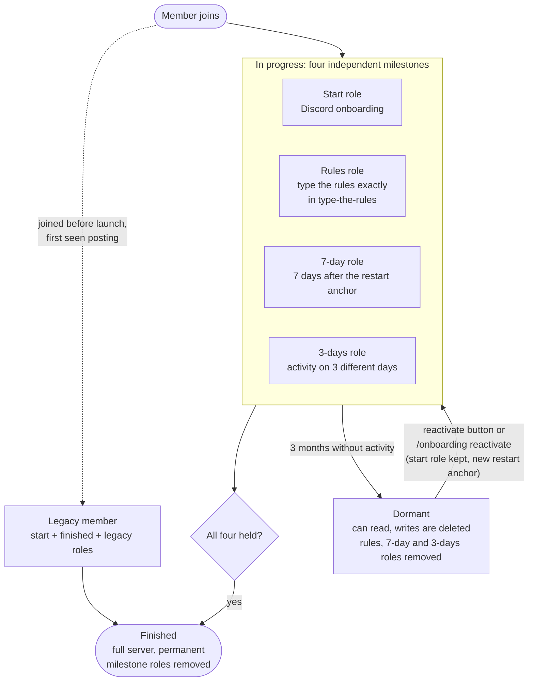
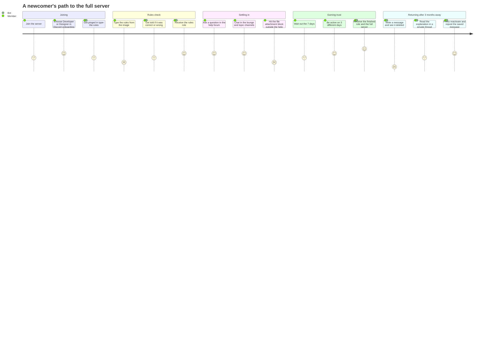

# Onboarding: a role-based member journey

## Problem and goals

Regulars have said they are tired of dealing with low-quality content from new joiners every day: badly formed help requests, and "look at my site" posts for projects that are fully vibe coded. They would prefer a calmer environment, with newcomers kept out of general chat and given the lounge instead. The trigger for this work is low-effort help requests, not a specific spam incident.

Onboarding exists to serve these goals, in this order of weight:

1. **Protect regulars' attention.** Keep newcomers out of general chat and the rest of the server until they have had time to settle in. Channels that newcomers cannot access are **hidden entirely** rather than shown as read-only; showing read-only channels would invite questions in write-accessible channels about why they cannot participate, creating the very distraction this goal seeks to avoid. Newcomers cannot create showcases, because that goes through a bot button in a channel they cannot reach. They can comment on showcases and take part in the help forum from the start.
2. **Server comprehension.** The 7-day wait gives newcomers time to read the rules and see how good questions are asked before they reach the whole server. To get the rules role, a newcomer must also type out the rules exactly, from an image, in the type-the-rules channel. The image stops copy and paste, so they have to read the text as they type. It checks effort, not understanding.
3. **Spam and raids.** Fresh accounts have limited reach while trust is unknown. Members who have not finished cannot attach files outside the help forum, which blocks file-based spam payloads.
4. **Drive-by accounts.** People who join, post once and leave should not cost moderators time.
5. **Limit hijacked dormant accounts.** An account that has shown no activity for months can later be compromised and used to post scam messages. A member who has not finished Onboarding and has no activity for 3 months loses the ability to write. Activity means writing a message anywhere, creating a forum post, or joining a voice channel. Finished members are never made dormant, so this goal does not cover them.
6. **Encourage participation.** Newcomers get a friendly place to take part straight away (the lounge and a few topic channels) and a path to the rest. The start role intentionally grants access to multiple channels after Discord onboarding, not just one or two, because newcomers need enough spaces to chat and be welcomed into the community. Without access to several active channels, newcomers may feel the server has little to offer and leave before completing onboarding.

Reading is not restricted by this flow. Members who read but rarely post keep their access to read the server. Onboarding gates where a member can write, not whether they may be here. A dormant member can read but cannot write until they reactivate.

### What the gates do and do not do

The 7-day wait and the 3-days-of-activity requirement are deliberate friction. They keep newcomers out of general chat and the rest of the server while they settle in, and they cost a drive-by account some effort. The 7 days make a throwaway account wait before it reaches everything. Requiring activity on 3 different days shows the member returns to chat and join in, which is a more meaningful sign of trust than an arbitrary character count. They do not judge quality. A member can still create a low-effort help request in the help forum, which the start role opens. Moderation and the community's own norms remain responsible for quality. Onboarding only limits how much of the server a newcomer can reach while that happens.

Every gate in section 1 must trace back to one of these goals. A gate that serves none of them should be removed.

## 1. What Onboarding is

Regulars are tired of low-effort posts from newcomers. **Onboarding** solves this by restricting new members' access until they prove they are trustworthy. It is a bot-managed role progression, separate from Discord's built-in onboarding (which only assigns a role like Developer or Designer).

The bot grants access in stages by assigning Discord roles, which control which channels a member can see and write in. Newcomers must complete four milestones to gain full server access:

1. Complete Discord onboarding (start role)
2. Wait 7 days from the **restart anchor**
3. Be active on 3 different days
4. Pass a rules check

Members who do not finish and then go 3 months without activity become **dormant**: they can read but cannot write. They can reactivate at any time.

> **Restart anchor:** The later of the member's join date or their latest rectification (if they were dormant and reactivated). The 7-day clock and activity-day count both run from this point.

### The journey

| **Role**     | **How Earned**                           | **Grants Access To**                                                         | **Notes**                                                                                              |
| ------------ | ---------------------------------------- | ---------------------------------------------------------------------------- | ------------------------------------------------------------------------------------------------------ |
| **Everyone** | Default state (no onboarding roles)      | Lounge, type-the-rules, announcements, rules                                 | Can open mod tickets                                                                                   |
| **Start**    | Discord onboarding                       | Help forum, ai, gaming, real-life, frontend, design-ui-ux, backend-and-cloud | Can comment on showcases                                                                               |
| **7-day**    | 7 days after restart anchor              | _None (milestone only)_                                                      | Auto-granted                                                                                           |
| **3-days**   | Activity on 3 distinct days              | _None (milestone only)_                                                      | Auto-granted                                                                                           |
| **Rules**    | Type rules from image in #type-the-rules | _None (milestone only)_                                                      | Bot checks message against rules text, deletes message, informs user of result, grants role if correct |
| **Finished** | Holds Start + 7-day + 3-days + Rules     | All channels, can attach files                                               | Permanent; milestone roles removed                                                                     |
| **Dormant**  | 3 months of inactivity (no Finished)     | Read-only                                                                    | Writes deleted, 10-min timeout, private thread with reactivate button                                  |
| **Legacy**   | Joined before launch                     | All channels                                                                 | Receives Start + Finished + Legacy at once                                                             |

### Rules

- **Activity** is writing a message anywhere (a forum post counts), or joining a voice channel. The bot cannot tell whether someone speaks, only that they joined. It stores the time of the member's last activity, and updates it only when the stored time is older than a set interval, because dormancy is measured in months. A new member's last activity starts as their join date.
- Dormancy runs from last activity: 3 months with none, for anyone without the finished role, including members who never held the start role. Finished members are never made dormant.
- When a dormant member writes, their message is deleted immediately, they receive a 10-minute timeout, and the bot creates a private thread in that channel, adds the member, and posts an explanation with a reactivate button and the text of the deleted message, so the member can repost it once reactivated. This **soft block** approach ensures the user learns about their dormant status at the moment of attempt and is given a clear, actionable path forward without having to search the server. The timeout prevents spam and is removed when the member reactivates.
- A member who has no start role (for example, skipped Discord onboarding) stays limited to the lounge until they complete Discord onboarding themselves. They are not nudged about Discord onboarding.
- Finishing needs the start role. A member could meet the 7-day, 3-days and rules conditions without it, but the finished role waits until Discord onboarding has been completed.
- The **rules check** replaces the quiz Discord onboarding used to show. In the type-the-rules channel, a new channel Everyone can write in, a pinned message tells the member what to do and the rules are shown as an image and the member types them out exactly as written, not in their own words. The bot compares the message with the rules text, ignoring case and extra whitespace; every word must match. A match grants the rules role. The message is deleted afterwards, whether it passed or failed, so the answer is not left for others to copy. The bot replies to say whether the attempt was correct or wrong, and that reply is deleted after 1 minute. The rules role is independent of the start role: a member can hold either first.
- The rules image carries the full rules text as its alt text, so screen reader users can complete the check. Members who cannot use the image for another reason are told in the type-the-rules channel to message mods, and a moderator can grant the rules role with a command. Alt text is easy to extract, so the check is friction, not a security control. The image URL and the rules text the bot compares against are constants a human maintains by hand. Nothing checks that they match.
- A member without the rules role is pinged in the type-the-rules channel when they join, each time their last activity is updated, and each time they are granted a new onboarding role. Each ping message is deleted after 2 minutes. The pings stop once the rules role is granted.
- Members who have not finished cannot attach files, except in the help forum, where images are allowed. Moderators set this in Discord by denying Attach Files to everyone except the finished role, outside the help forum. The bot does nothing for it, in line with the roles-only rule below. Links and embeds are not restricted. This serves goal 3 only.
- Activity on a day is recorded once per calendar day, regardless of how many messages are sent. Activity means writing a message anywhere (a forum post counts), or joining a voice channel. A member must record activity on 3 distinct days to earn the 3-days role.
- **Rectification** leaves dormancy. A moderator runs `/onboarding reactivate @member`, or the member presses the button in the dormant channel. Both remove the dormant role, set a new restart anchor and set last activity to now. The day count is already empty, because it is cleared when the member becomes dormant, and activity from a member holding the dormant role is not counted. A returning member starts over on purpose, with another 7 days, 3 days of activity and the rules check: the point is to show they are present again.
- The 3-days role is held only while the activity-day count stays at or above 3. If a member's activity days are deleted or reset, the role is removed.
- A member who leaves keeps their Onboarding progress for a grace period of 7 days, counted from when the daily job first notices they are gone. If they rejoin within it, their activity-day count is as it was, however soon after leaving they return, and the rules role is given back because the Onboarding record also stores that they passed the rules check. The time away does not count toward the 7 days or the dormancy deadline: the restart anchor and last activity move forward by the time away, measured from when the daily job noticed the leave until the rejoin. After the grace period the progress is deleted and they start Onboarding again. Members who had already finished always start again, because their record is gone and Discord removes their roles when they leave. Activity-day records are only deleted in two cases: their onboarding record is deleted (they finished, or the grace period after leaving ran out), or they become dormant.
- Bots and moderators (**exempt members**) are never touched.
- Which channels each role can see or write in is configured by moderators in Discord. The bot only adds and removes roles. It never edits channel permission overwrites.

### The flow at a glance

### A newcomer's journey

The scores are a rough 1 to 5 guess at how the step feels to the member, where 1 is frustrating and 5 is pleasant. They mark where the design asks the most of people.

## 2. The decision

Onboarding is implemented as a role reconciler that works **with the GuildMembers privileged intent**. It relies on proper Discord events for joins, leaves, and role updates, along with a tracking table for activity days and dormancy.

**Fallback:** If the GuildMembers intent application is denied, the bot can fall back to the approach described in section 3.1, which uses system messages, per-message events, and a daily job to fetch members one by one.

### Why use the intent

The intent is the most straightforward route. It delivers join, leave and role-update events in real-time and lets the bot list every member. This app already requires approval for the Message Content intent (privileged, see `src/index.ts:17`), so applying for GuildMembers follows the same process. Using the intent eliminates the technical debt of workarounds and provides cleaner, more reliable functionality.

### What this gives us (with GuildMembers intent)

- Roles granted outside the bot (Discord onboarding giving the start role) are noticed immediately via role-update events.
- Leaves are noticed immediately via leave events, enabling accurate grace period tracking.
- Time-based roles (7-day, dormant) can be applied in real-time or via scheduled jobs.
- Existing members can be listed, enabling a clean backfill of legacy members.
- Dormancy can be comprehensive: all members can be evaluated, not just those the bot saw join or post.
- The leave grace period starts exactly when the member left.

### Fallback costs (without GuildMembers intent)

If the intent is not approved, the fallback approach has these costs:

- Roles granted outside the bot are noticed late: when the member next posts, or at the next daily run.
- Leaves are noticed late, at the next daily run.
- Time-based roles (7-day, dormant) are applied once a day, so they can arrive up to a day late.
- Existing members can't be listed, so they become **legacy members** one at a time, as they post.
- Dormancy is best-effort. It only covers members the bot saw join or post. A silent member whose join message was missed is invisible to the daily run, and a legacy member who never posts is never evaluated, so neither goes dormant and both stay exposed to the hijacked-account risk in the goals. This is accepted.
- The leave grace period starts when the daily job notices the leave, not when the member left, so it can run up to a day longer than 7 days.

## 3. Technical design

### Signals the bot uses (with GuildMembers intent)

| Need               | Source                                            | Needs privileged intent |
| ------------------ | ------------------------------------------------- | ----------------------- |
| A member joined    | `GuildMemberAdd` event                            | Yes (GuildMembers)      |
| Join date, roles   | `GuildMemberAdd` event or `guild.members.fetch()` | Yes (GuildMembers)      |
| Activity tracked   | `MessageCreate`, `VoiceStateUpdate` events        | No                      |
| Member left        | `GuildMemberRemove` event                         | Yes (GuildMembers)      |
| Start role granted | `GuildMemberUpdate` event (role change)           | Yes (GuildMembers)      |

**Fallback signals (without GuildMembers intent):**

- A member joined: System join message (`MessageType.UserJoin`) in the server's system channel
- Join date, roles: `message.member` on every guild message
- Member left: Daily run fetches each tracked member by ID and treats Discord's "Unknown Member" error (code 10007) as a leave
- Start role granted: Seen on the member's next message, or when the daily run fetches them

Note: Spam detection removes messages with `bulkDelete`. discord.js reports that with a separate bulk-delete event, and the bot has no delete listeners today.

### Data

Three Prisma models in [schema.prisma](../../prisma/schema.prisma):

- **Onboarding**: one row per member who is actively in the onboarding process (not finished, not dormant). Columns are the user ID (primary key), join date, restart anchor, last activity date, activity days count (number of distinct days with activity), and the time the bot first noticed the member had left (empty while they are in the server). The row is deleted when the member finishes, becomes dormant, or when the grace period after leaving has ended.
- **Dormant**: one row per dormant member. Columns are the user ID (primary key), dormancy start date, and last activity date. The row is deleted when the member is removed from the server (after leaving with no rejoin within grace period) or when they reactivate.
- **OnboardingActivityDay**: one row per distinct day of activity for a member. Columns are a composite primary key of user ID and date. This table tracks which days a member was active. A member's total is the count of their rows.

Roles are not mirrored in the database. Discord's role list is the source of truth for the current stage, and the tables hold only what Discord cannot tell us (the anchor, activity days, and dormancy state).

**Fallback note:** Without GuildMembers intent, the Dormant table would be merged into Onboarding with a status column, as the bot cannot reliably detect when members leave.

### Why activity days get their own table

Tracking activity per day in a separate table allows:

- Efficient counting of distinct days without complex queries
- Easy insertion of a new day's activity (insert if not exists)
- Clean deletion when a member finishes or becomes dormant (cascade delete)
- Replays (startup catch-up, duplicate events) become idempotent inserts on the composite primary key

The `OnboardingActivityDay` table declares its relation to `Onboarding` with `onDelete: Cascade`, so deleting a member's `Onboarding` row deletes all of their activity day rows in the same operation. When a member becomes dormant, their activity day rows are explicitly deleted.

SQLite only enforces foreign keys when they are switched on for the connection. A test must confirm the cascade really fires with the better-sqlite3 adapter in use.

### One decision function

All entry points call the same two pieces:

1. A pure function takes the member's roles, restart anchor, activity days count, join date and the current time, and returns the roles to add and remove. It has no Discord calls, so it can be unit-tested.
2. An applier makes the role changes and writes a line to the onboarding log channel.

Evaluation order inside the pure function:

1. **Exempt member**: nothing.
2. **Finished role present**: remove any leftover 7-day and 3-days roles, stop tracking.
3. **Joined before the launch date**: add start, finished and legacy.
4. **Dormant role present**: nothing until rectification.
5. **3 months past the anchor**: remove 7-day and 3-days, add dormant, move to Dormant table, delete the member's activity day rows.
6. **7 days past the anchor**: add 7-day.
7. **3 activity days**: add 3-days role. Below 3 while holding the 3-days role: remove it.
8. **Start, 7-day and 3-days all held**: add finished, remove 7-day and 3-days, delete Onboarding row.

Role changes run one at a time, as the existing [addRoleToUser](../../src/util/add-role-to-user.ts) does, so a large first run stays inside Discord's rate limits. Functions throw when they cannot complete their job and the caller handles it.

### Entry points (with GuildMembers intent)

- **Member join** (`GuildMemberAdd`): create the member's `Onboarding` row with join date as restart anchor and initial last activity.
- **Message create** (`MessageCreate`): if the member is not exempt and not finished, create tracking row if missing, record activity day if the message is after the anchor and it's a new calendar day, then evaluate.
- **Voice state update** (`VoiceStateUpdate`): if the member joined a voice channel and is not exempt and not finished, create tracking row if missing, record activity day if it's a new calendar day, then evaluate.
- **Member leave** (`GuildMemberRemove`): record leave time in Onboarding row. If no rejoin within 7 days, delete the row.
- **Member update** (`GuildMemberUpdate`): if start role is granted and member has Onboarding row, evaluate.
- **Daily job**: scheduled with `node-cron` at a fixed UTC time. For each tracked member, re-evaluate. For dormant members, check if they should be removed from the Dormant table.
- **Rectification**: a shared function checks the member holds the dormant role (throws if not), removes it, creates a new Onboarding row with anchor set to now, and evaluates. The `/onboarding reactivate` slash command and the dormant-channel button both call it.

**Fallback entry points (without GuildMembers intent):**

- **Join message**: create the member's `Onboarding` row. If a row already exists, the bot clears its left time.
- **Any guild message from a member who is not exempt and not finished**: if there is no tracking row, create one from `message.member.joinedAt`. Record activity day, then evaluate.
- **Daily job**: For each tracked member, fetch by ID. If gone, record leave time; if present after grace period, delete row.
- **Startup catch-up**: fetch recent history of the system channel and replay join messages the bot missed while offline.

### Dormant channel

At startup the bot makes sure one fixed message with a "Reactivate" button exists in the dormant channel, and posts it if missing. This serves as a reference point for dormant users. The placeholder text says the account has been dormant and the member should press the button to restart onboarding. The final wording is a constant that will be replaced later. The button is handled by the persistent interaction handlers so it survives restarts, and it rejects members without the dormant role.

**Note:** With Option B chosen, this shared message is supplementary. The primary notification mechanism is the private thread created when a dormant member attempts to write.

### Configuration

- **Constants** in one onboarding config file: days until the 7-day role (7), activity days required (3), dormancy period (3 months), leave grace period (7 days), daily-job time, launch-date constant.
- **Required env vars** in [env.ts](../../src/env.ts): the five onboarding role IDs plus the legacy role ID, the dormant channel ID and the onboarding log channel ID, and the launch date. The optional `ONBOARDING_ROLE_ID` and `ONBOARDING_CHANNEL_ID` and the unused `/onboarding` stub are removed.
- **Permissions**: the bot's own role must sit above all onboarding roles and have Manage Roles, Moderate Members (for applying timeouts), View Channel on the system channel, and (with GuildMembers intent) the GuildMembers privileged intent enabled in the Developer Portal.
- **Intent configuration**: Enable GuildMembers intent in `src/index.ts`. If the intent is not approved, fall back to the system message approach.

## 4. Considered options

- **Use GuildMembers intent (CHOSEN).** Simplest design. It provides real-time events for joins, leaves, and role changes, and allows listing all members for a clean backfill. Requires approval for servers with 10,000+ users, but this server may be below that threshold. Fallback to the system message approach if approval is denied.
- **Activity-based trust instead of character count (CHOSEN).** Using 3 days of activity is more meaningful than a 400-character threshold. It better aligns with Goal 1 (protecting regulars) by ensuring users return to engage, rather than just posting a long message once.
- **Separate Dormant table (CHOSEN).** Keeping active and dormant users in separate tables makes the data model clearer and allows the Onboarding table to only contain users actively progressing.
- **Keep a running character total per member instead of per-message records.** Less storage. Rejected because deleted and spam-removed messages must stop counting, and a total alone cannot tell which characters to subtract.
- **One table, with the per-message lengths in a JSON column on `Onboarding`** (message ID mapped to counted length). Simpler schema, one read for a member's whole state, and one delete for cleanup. Rejected for three reasons. Every update is a read-modify-write of the whole column, so two events for the same member can silently overwrite each other unless updates are serialised per member. A delete event for an uncached message gives only the message ID, so finding the member who owns it means scanning every member's JSON with raw SQL. And the total would be computed in code, with the whole blob rewritten on every message. Fixing the first two with a per-member lock and a message-to-member lookup would rebuild the second table in a worse form.
- **Restore finished members who leave and rejoin.** Would need a permanent record of every finished member. Without the intent the bot only learns of a rejoin, never of the leave, so the 7-day grace period given to in-progress members cannot be applied: the choices are restoring access whenever they return, or guessing from the finish time. Rejected to keep the design small and not grant full access automatically; a finished member who returns starts again.
- **Hourly job instead of daily.** Faster role delivery. Not chosen: a daily job was the requirement and the lag is acceptable.
- **Deny Send Messages to the dormant role (hard block).** No bot handling of messages, no brief visibility of the message, and no Manage Messages or Moderate Members permission. Rejected for two reasons. The member sees a disabled or blocked message box with Discord's generic notice and no path to reactivate, and members rarely investigate, so they churn or ask in chat why they see nothing. And it needs a dormant-role overwrite in every channel, which moderators would have to maintain, against the rule that onboarding only moves roles.
- **Bot manages channel permission overwrites.** Would let the bot enforce what "dormant" means. Rejected because channel permissions belong to moderators and the onboarding flow is meant to be roles only.

## 5. To verify before building

### With GuildMembers intent:

- That the bot receives `GuildMemberAdd`, `GuildMemberRemove`, and `GuildMemberUpdate` events.
- That the bot can list all members to backfill legacy members.
- That `VoiceStateUpdate` events are received to track voice channel joins.

### Fallback (without GuildMembers intent):

- That the bot can see and read the system join messages in the real server, and that welcome messages are enabled there.
- That fetching a single member by ID works with the intent off. Discord's docs say only List Guild Members requires the intent. The Get Guild Member page does not mention one, and the existing stub in [features/onboarding](../../src/features/onboarding/index.ts) already calls it.

### For both approaches:

- That activity day tracking correctly identifies distinct calendar days.
- That the separate Dormant table works as expected.
- That the private thread notification works as expected: creation, member addition, button functionality, and thread cleanup.

### Decision: making dormant members read-only

**Decision: Option B (Delete and notify with private thread) has been chosen.**

A dormant member must be able to read the server but not write anywhere, including the lounge. The chosen approach uses a **soft block** pattern with **just-in-time education**: the bot allows the write attempt to proceed, then intercepts it to provide immediate, actionable feedback. This is also known as **forgiving degradation** or **progressive intervention**—the system doesn't silently fail or permanently block, but instead converts the failure into a learning moment.

**Implementation:** When a dormant member writes a message, the bot:

1. Deletes the message immediately (requires Manage Messages permission)
2. Applies a **10-minute timeout** to the member (prevents further posts during this period)
3. Creates a private thread in the channel where the message was posted
4. Adds the member and the bot to the private thread
5. Posts an explanation that the account is dormant, the text of the deleted message so the member does not lose it, and a reactivate button. Only the text is copied; attachments are not, and unfinished members cannot attach files anyway

When the member presses the reactivate button, the bot removes the timeout, removes the dormant role, and proceeds with rectification. The member is notified because they were added to the thread, giving them a clear, visible path to reactivation without having to search the server or leave to figure out what happened.

**Why Option B over Option A:**

- **User retention:** A user who cannot write at all (**hard block**) is more likely to churn and leave the server entirely. A soft block keeps them engaged and provides immediate guidance.
- **Discovery:** Users learn about their dormant status naturally through use, rather than having to investigate why they can't post.
- **Actionable:** The notification includes the reactivate button right next to the explanation, making the next step obvious.

**Trade-offs accepted:**

- The offending message is briefly visible before deletion. It can ping people and unfurl links, which weakens Goal 5 (hijacked dormant accounts). This is mitigated by the immediate 10-minute timeout that prevents follow-up posts.
- A member who wrote a long, good-faith reply loses it from the channel and gets a timeout, which can feel like a punishment. Copying the text into the thread lets them repost it right after reactivating, which is immediate. The 10-minute timeout is kept because it stops follow-up posts and thread spam; this friction is accepted.
- The bot must have Manage Messages permission and Moderate Members permission (for applying timeouts) and handle every guild message from dormant members.
- Each dormant member who writes creates a new private thread. The bot needs permission to create private threads and add members. The 10-minute timeout prevents rapid successive thread creation from the same user.

### Telling the member

With Option B chosen, the telling happens **just-in-time** when the dormant member attempts to write. A private thread is created in the channel where they tried to post, which does not fail when DMs are closed, keeps the message inside the server, and places the reactivate button next to the explanation. The member is notified because they were added to the thread.

This approach replaces the single shared button message in the dormant channel, though that message can remain as a reference point.

**To verify before relying on it:**

- A member added to a private thread can see and use it when the parent channel is otherwise hidden from them.
- The bot has permission to create private threads and add members.
- The bot has Moderate Members permission to apply and remove the 10-minute timeout.
- The number of threads stays manageable. Consider archiving threads after reactivation or after a period of inactivity.
- The delete-and-create-thread sequence is atomic enough that the message doesn't persist long enough to cause harm.
- The 10-minute timeout is applied correctly and removed upon reactivation.
