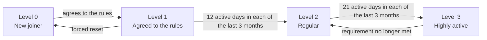
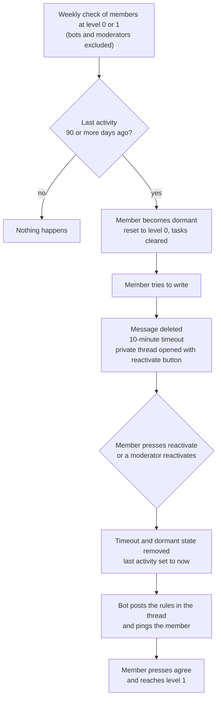

# Onboarding

> DRAFT: Business Definition under review. Milestones are not yet defined.

## 1. Business Definition

### Purpose

Onboarding keeps new members in a contained space while they settle in, and gives them a clear path to the rest of the server.

### Problem

Regulars are annoyed by a steady stream of newcomer noise:

- simple, badly formed help requests
- "look at my project" drop-ins, often fully vibe coded
- new joiners entering random voice channels
- solicitation and spam

### Goals

1. **Protect regulars' attention.** Newcomers chat in a separate space and do not reach general chat or open voice channels at first.
2. **Give newcomers somewhere to belong.** They can talk from the first minute, and they have a visible way to progress.
3. **Reward participation.** Members who stay and contribute gain access and recognition.
4. **Limit spam and abuse.** New and long-dormant accounts have limited reach: no attachments, no open voice.

### Success criteria

- Regulars report less newcomer noise in general chat and voice.
- Newcomers still participate and a meaningful share progress past level 0.
- Moderators do not have to manage progression by hand.

## 2. Business Concepts

> DRAFT: Concepts under review.

### Activity

An **activity** is one day on which a member interacted with the server in a meaningful way: writing a message, creating a thread or forum post, or joining a voice channel. It does not matter how long the interaction lasted or how many times the member interacted that day. A day with any interaction counts as exactly one activity.

Everything in this document that is measured in "activity" is measured in days. Days and months are always in UTC.

### Levels

A member's **level** says how much of the server they can reach. There are four levels, numbered 0 to 3.

Levels are earned strictly in order and none can be skipped: 0, then 1, then 2, then 3. A member only moves up when the previous level has been granted, so two levels are never granted at the same time. The only ways down are from level 3 to level 2, and a forced reset to level 0.

Which channels each level can see or write in is decided by moderators in Discord. The bot only assigns and removes the level roles.

### Level 0: New joiner

Every new member starts here.

- Cannot access general chat.
- Cannot access voice channels, except 1-on-1 voice channels.
- Cannot add attachments.

### Level 1: Agreed to the rules

A member reaches level 1 by agreeing to the rules. The bot asks in a dedicated channel (name to be defined), and the member presses a button to agree. This is the only requirement.

- Gains access to general chat and all voice channels.
- Can add attachments.

#### Welcome message and tasks

Right after a member agrees, the bot writes a message in the same channel, welcoming them to the server and telling them to go to #bot-commands and run the `/onboarding` command.

The command replies privately to the member who ran it, with a **task list**. Tasks are suggestions that help a member join in. Unless a task is marked (required), it is optional. There are no rewards. Tasks exist to motivate people to take part.

A task that the member has completed is shown as checked off. The starting tasks are:

- Agree to the rules (required).
- Run `/onboarding` in #bot-commands.
- Introduce yourself in #introduction, using a template.
- Post a meme in #memes.
- Share a hobby you have in real life, in #real-life.
- Say hi to the community in #lounge.

Any member can run `/onboarding`, at any level.

The bot starts checking a member's tasks from the moment they join, and keeps checking at all times. A task is checked off when:

- Agree to the rules: the member has pressed the agree button.
- Run `/onboarding` in #bot-commands: the member has run the command in #bot-commands. Running it in another channel does not count.
- Introduce yourself, share a hobby, say hi: the member has posted any message in that channel.
- Post a meme: the member has posted a message with an attachment in #memes. Level 0 members cannot add attachments, so they must reach level 1 first.

More tasks can be added over time.

### Level 2: Regular

A member at level 1 reaches level 2 by being active on at least **12 days in each of the last 3 calendar months**. The 12 days must be reached in every one of the 3 months. A total of 36 days across 3 months is not enough, because those days could be packed into a stretch shorter than 3 months.

- Gains access to the VIP area.

Level 2 does not depend on later activity. Once earned, it is not lost for being less active. Members who held the "Regular" or "VC Regular" role before this system launched start at level 2.

### Level 3: Highly active

A member at level 2 reaches level 3 by being active on at least **21 days in each of the last 3 calendar months**. It is an aesthetic recognition and grants no access.

Unlike the other levels, level 3 can be lost. When a member no longer meets the requirement, they return to level 2. They can earn level 3 again by meeting the requirement again.

### Level overview

### Monthly evaluation

Levels 0 and 1 are granted as soon as the member qualifies. Levels 2 and 3 are decided on the **first day of each month**. On that day the bot looks at each member's activity in the 3 calendar months before the current one, and grants or removes levels 2 and 3. The current month is never counted. For example, on April 1st the bot looks at January, February and March.

Because a member can only move up one level per check, and level 3 needs level 2 first:

- A member who qualifies for both levels 2 and 3 gets level 2 on the first check and must wait for the next check for level 3.
- Reaching level 2 takes at least 3 months in the server, and reaching level 3 at least 4 months.

### Dormancy

Once a week, the bot checks every member at level 0 or 1, except bots and moderators. A member whose last activity was 90 or more days ago becomes **dormant** and is reset to level 0 at that moment, and all of their completed tasks are cleared. Activity is counted in whole days, so the time of day is ignored. Members at level 2 or above never become dormant.

A dormant member can still read the server, but cannot write. The member learns of the dormancy when they try to write:

1. The bot deletes the message and times the member out for 10 minutes.
2. The bot opens a private thread with the member, explaining that the account is dormant. It repeats the text of the deleted message so it is not lost, and offers a reactivate button.
3. The member presses the reactivate button in that thread. A moderator can also reactivate a member.
4. The timeout and the dormant state are removed, and the member's last activity is set to now. The member is at level 0 and starts again from there.
5. In the same thread, the bot posts a message that pings the member, shows the rules, and has a button to agree, as for level 1.

### Leaving and rejoining

When a member leaves the server, the bot keeps their progress (level, activity and completed tasks) for **seven days**. This applies to every level. If they rejoin within those seven days, their progress is restored as it was. After seven days the progress is deleted, and a member who returns starts at level 0 as a new joiner.

### Existing members at launch

Members who joined before the system launched start at level 1, except holders of the "Regular" or "VC Regular" role, who start at level 2.

### Exempt members

Bots are never assigned levels and are never made dormant. Moderators gain levels like any other member, but are never made dormant.
