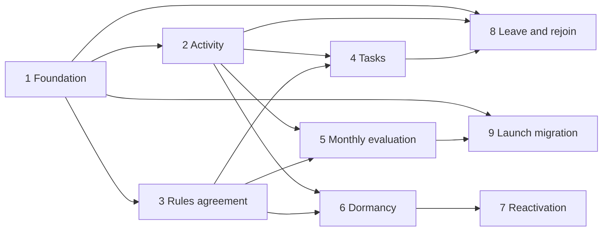

# Onboarding: Implementation Plan

Implements [onboarding.md](onboarding.md). This plan is one **epic** with nine **child items**. Each child item is one feature that can be built, reviewed and merged on its own. When every child item is merged, the epic is done and the spec is implemented.

## How to use this plan

- Create one GitHub issue for the epic and one issue per child item. Each child issue links to the epic.
- Each child item has a Why, Scope, Acceptance criteria and Out of scope section. These become the body of its issue.
- One child item is one branch and one pull request (`feat/<issue-number>/<short-description>`).
- Every child item ships with unit tests for its pure logic. Business rules go in pure functions that take the current time as an argument, so they can be tested without Discord.
- Until the last child item is merged, nothing the member can see changes in production. Items that need a switch to stay hidden use the `onboarding` feature flag from item 1.

## Epic

**Title:** Onboarding: levels, tasks and dormancy

**Why:** Regulars are tired of newcomer noise. Onboarding keeps new members in a contained space, gives them a path to the rest of the server, and rewards members who stay. Moderators should not have to manage progression by hand.

**Done when:**

- Every child item below is merged.
- A new member goes 0, 1, 2, 3 on their own, following the spec.
- Dormancy, leaving and rejoining behave as the spec describes.
- Existing members have been migrated to their launch level.
- Moderators have configured channel permissions per level in Discord (not done by the bot).

## Child items at a glance

| #   | Child item                                  | Spec sections                                   | Depends on |
| --- | ------------------------------------------- | ----------------------------------------------- | ---------- |
| 1   | Level foundation: data, roles, configuration | Levels, Exempt members                          | none       |
| 2   | Activity tracking                           | Activity                                        | 1          |
| 3   | Rules agreement: level 0 to level 1         | Level 1                                         | 1          |
| 4   | Tasks and the `/onboarding` command         | Level 1: welcome message and tasks              | 2, 3       |
| 5   | Monthly evaluation: levels 2 and 3          | Level 2, Level 3, Monthly evaluation            | 2, 3       |
| 6   | Dormancy: weekly check and soft block       | Dormancy (steps 1 and 2)                        | 2, 3       |
| 7   | Reactivation                                | Dormancy (steps 3 to 5)                         | 6          |
| 8   | Leaving and rejoining                       | Leaving and rejoining                           | 1, 2, 4    |
| 9   | Launch migration                            | Existing members at launch                      | 1, 5       |

Items 2 and 3 can be built in parallel. Items 4, 5 and 6 can be built in parallel once 2 and 3 are merged.

## Decisions for the whole epic

1. **GuildMembers intent.** The bot uses the GuildMembers intent. It receives join and leave events and can list all members. Item 1 adds the intent to the client in `src/index.ts`.
2. **Level 0 is a Discord role.** A new member receives it on join.
3. **Levels are cumulative.** A member at level N holds the roles for levels 0 to N. A level 3 member holds four roles. Moving up adds one role, losing level 3 removes one role, and a forced reset to level 0 removes the roles for levels 1 to 3 and keeps level 0.
4. **Names.** The rules channel name is still to be defined. Role IDs and channel IDs go into `src/env.ts`.

---

## 1. Level foundation: data, roles, configuration

**Why:** Every other item reads or changes a member's level. This item builds the shared base and changes nothing visible to members.

**Scope:**

- Prisma models and migration: a member progress record (user ID, level, last activity date, dormant flag, time of leaving). Roles are not mirrored beyond what Discord cannot tell us.
- Configuration in `src/env.ts` for the four level role IDs and the channel IDs used later. Remove the unused `/onboarding` stub that carries `@ts-expect-error` placeholders (a real command comes in item 4).
- A pure level function: given the current level and the facts about a member, return the new level. It enforces "one level at a time, strictly in order".
- A role applier: given a member and a target level, make the member hold exactly the roles for levels 0 to that level, adding and removing as needed. Never edits channel permission overwrites.
- Add the GuildMembers intent to the client in `src/index.ts`, and listen for member join (and leave, used in item 8).
- Exemption rules: bots are never given a level and never dormant; moderators gain levels but are never dormant.
- An `onboarding` feature flag in `src/env.ts`. Every later item checks it, so the system stays dark until launch.
- New members receive the level 0 role when they join.

**Acceptance criteria:**

- With the flag off, the bot does nothing onboarding related.
- A new member gets the level 0 role on join; a bot gets nothing.
- A member at level N holds exactly the roles for levels 0 to N; applying a level removes roles above it.
- The level function never skips a level and only goes down from 3 to 2 or by a forced reset to 0.
- The role applier is idempotent: applying the same level twice changes nothing.
- Unit tests cover the level function and the exemption rules.

**Out of scope:** granting any level above 0, activity, commands, backfilling existing members.

## 2. Activity tracking

**Why:** Levels 2 and 3 and dormancy all depend on knowing which days a member was active.

**Scope:**

- One row per member per UTC day (`userId`, `date`, composite primary key). Insert is idempotent, so replays and duplicate events are harmless.
- Count an activity on: a message, a new thread or forum post, joining a voice channel. Not on leaving or moving inside voice.
- Update the member's last activity date.
- Do not count activity from bots. Do not count activity by dormant members (their message is deleted, see item 6).
- Pure helpers: UTC day of a timestamp, active days per calendar month, "active on at least N days in each of the last 3 calendar months".

**Acceptance criteria:**

- Ten messages on one day produce one row.
- Days and months are UTC, including around midnight and month boundaries.
- Joining a voice channel counts; staying in it does not add more.
- The "at least N days in each of the last 3 months" helper rejects 36 days packed into two months. Tests cover this case and the year boundary (January looks at October to December).
- The current month is never counted.

**Out of scope:** granting levels from activity (item 5), dormancy (item 6).

## 3. Rules agreement: level 0 to level 1

**Why:** Agreeing to the rules is the only requirement for level 1, and it opens general chat, voice and attachments.

**Scope:**

- A message with an agree button in the rules channel. Pressing it moves a level 0 member to level 1.
- The button works only for level 0 members. Other levels get a short private reply.
- Right after the member agrees, the bot writes a welcome message in the same channel. It tells them to go to #bot-commands and run `/onboarding`.
- The agree flow is a reusable function, because item 7 posts the same rules and button inside the dormant thread.

**Acceptance criteria:**

- Pressing agree at level 0 gives level 1 and posts the welcome message.
- Pressing it at any other level changes nothing.
- The button still works after a bot restart (no in-memory collector).
- The action is recorded so item 4 can check off "Agree to the rules".

**Out of scope:** the task list and `/onboarding` command (item 4), reactivation thread (item 7).

## 4. Tasks and the `/onboarding` command

**Why:** Tasks motivate newcomers to take part. They have no rewards and gate nothing, except that "Agree to the rules" is marked required.

**Scope:**

- A task definition list in code (id, label, required flag, and the check that completes it). Adding a task later is a one-line change.
- A table of completed tasks per member.
- Event handlers that complete tasks, running from the moment a member joins and at all times:
  - Agree to the rules: the agree button was pressed.
  - Run `/onboarding`: only counts when run in #bot-commands.
  - Introduce yourself, share a hobby, say hi: any message in the matching channel.
  - Post a meme: a message with an attachment in #memes.
- The `/onboarding` slash command, available at every level, replying privately with the task list and checked-off tasks.

**Acceptance criteria:**

- Tasks completed before the member first runs `/onboarding` are already checked off.
- `/onboarding` outside #bot-commands still replies, but does not complete its own task.
- A message without an attachment in #memes does not complete the meme task.
- A task is completed at most once. Tests cover each task check as a pure function.

**Out of scope:** clearing tasks on dormancy (item 6) and keeping them across a rejoin (item 8).

## 5. Monthly evaluation: levels 2 and 3

**Why:** Levels 2 and 3 reward members who stay, and moderators should not manage this by hand.

**Scope:**

- A scheduled job on the first day of each month (UTC), using the existing `node-cron` dependency.
- For each level 1 member: grant level 2 when active on at least 12 days in each of the last 3 calendar months.
- For each level 2 member: grant level 3 when active on at least 21 days in each of the last 3 calendar months.
- For each level 3 member: return to level 2 when the 21 day requirement is no longer met.
- Exempt bots are skipped. A member moves at most one level per run.
- The job is safe to run twice on the same day and to re-run by hand after a missed run.
- A log line per level change in the existing logging channel style.

**Acceptance criteria:**

- A member who qualifies for both 2 and 3 gets level 2 now and level 3 on the next run.
- Level 2 is never lost for low activity.
- On April 1st the job reads January, February and March.
- Reaching level 2 takes at least 3 months and level 3 at least 4, shown by tests on the pure decision function with fixed dates.
- The evaluation is a pure function; the job only fetches members and applies the result.

**Out of scope:** dormancy, the launch migration (item 9).

## 6. Dormancy: weekly check and soft block

**Why:** A long-quiet account can be taken over and used for scams. Members at levels 0 and 1 who have been inactive for 90 days lose the ability to write.

**Scope:**

- A weekly job over members at level 0 or 1, skipping bots and moderators. A member whose last activity was 90 or more days ago (in whole UTC days) becomes dormant: reset to level 0, completed tasks cleared, dormant flag set.
- Members at level 2 or above are never checked.
- A message listener: when a dormant member writes, the bot deletes the message, times the member out for 10 minutes, opens a private thread with the member, explains the dormancy and repeats the text of the deleted message. The thread carries a reactivate button (handled in item 7).
- Discord limits apply: check the bot can time out the member (role position) and fail with a logged error rather than a crash.

**Acceptance criteria:**

- A member inactive for 89 days is untouched; at 90 they become dormant.
- Time of day is ignored in the 90 day check.
- A dormant member can read but cannot write: the message is deleted every time.
- The deleted text appears in the thread, including long messages (split or truncated within Discord limits, with a test for the limit).
- Level 2 and 3 members, bots and moderators are never made dormant.

**Out of scope:** the reactivate button handler and the rules re-agree (item 7).

## 7. Reactivation

**Why:** A dormant member needs a clear way back, and moderators need to be able to do it for them.

**Scope:**

- The reactivate button handler in the dormant thread: remove the timeout and the dormant state, set last activity to now. The member stays at level 0.
- A moderator action to reactivate a member (subcommand of a moderator-only command).
- After reactivation the bot posts in the same thread: a ping to the member, the rules, and the agree button from item 3.
- Activity by the member before reactivation is not retroactively counted.

**Acceptance criteria:**

- Pressing the button removes the timeout and the dormant flag, and posts the rules and agree button in the thread.
- The button works only for the member the thread belongs to; a moderator can use the command for anyone.
- Agreeing in the thread brings the member to level 1, as in item 3.
- Reactivating a member who is not dormant gives a clear message and changes nothing.

**Out of scope:** changing the dormancy rules (item 6).

## 8. Leaving and rejoining

**Why:** A member who leaves briefly should not lose their progress, but old data must not live forever.

**Scope:**

- When a member leaves, record the time. Their level, activity and completed tasks are kept for seven days, at every level.
- When they rejoin inside seven days, restore the progress as it was, including the level role.
- A daily cleanup job deletes progress older than seven days after leaving. A member who returns after that starts at level 0.
- The weekly dormancy job and the monthly evaluation ignore members who have left.

**Acceptance criteria:**

- Rejoining after 6 days restores level, activity days and tasks. Rejoining after 8 days gives a new joiner at level 0.
- Deleting a member's progress also deletes their activity days and tasks in the same operation.
- Level 3 and level 2 members are covered, not only levels 0 and 1.

**Out of scope:** changing what counts as activity.

## 9. Launch migration

**Why:** Existing members must not be forced back through level 0 when the system goes live.

**Scope:**

- A one-off, re-runnable command or script. Members who joined before launch start at level 1. Holders of the "Regular" or "VC Regular" role start at level 2.
- Bots are skipped. Moderators get a level like anyone else.
- A dry run mode that reports counts per level before changing any roles.
- A launch checklist in this file or the epic: feature flag on, moderators have set channel permissions for every level, migration run, `/onboarding` tested in #bot-commands.

**Acceptance criteria:**

- Running the migration twice gives the same result.
- A dry run changes nothing and prints the counts.
- Members who already have a level are not downgraded.
- Existing members' activity history starts empty: the first monthly evaluation cannot promote them by itself, so nobody jumps a level they have not earned (the spec requires at least 3 months for level 2).

**Out of scope:** channel permissions in Discord (moderators do this).

---

## Suggested order of delivery

1. Item 1, then items 2 and 3 in parallel.
2. Items 4, 5 and 6 in parallel.
3. Items 7 and 8.
4. Item 9 and the launch checklist.

## Risks

- **GuildMembers intent.** It is a privileged intent: it must be enabled for the bot in the Discord developer portal before items 1, 6, 8 and 9 can run.
- **Moderator configuration.** The bot only assigns roles. Moderators must set per-level permissions in Discord before launch, or the roles do nothing.
- **Timeouts and role order.** Discord only lets the bot time out members whose highest role is below the bot's. Check this before launch.
